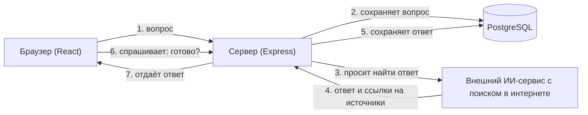
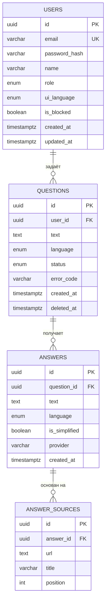
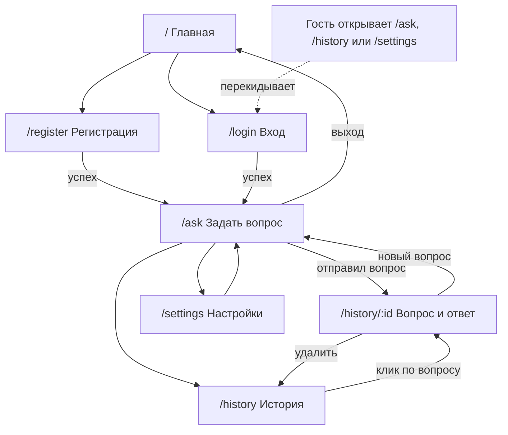

# Архитектура проекта «Ответчик»

> Стек (не меняется): React (Vite) + Node.js + Express + PostgreSQL + Prisma.
> Код в этом документе не пишется — только проектирование.
> Термины объясняются в скобках.

---

## 0. Что мы строим и какие решения приняты

**Идея.** Зарегистрированный пользователь задаёт вопрос. Сайт ищет ответ в интернете и показывает его. Если вопрос очень сложный, сайт объясняет мягко и как можно ближе к правильному ответу. История вопросов и ответов сохраняется.

**Твои ответы на уточняющие вопросы:**

| Вопрос | Ответ | Что это значит для архитектуры |
|---|---|---|
| Откуда ответы? | С любого источника | Нужен внешний сервис, который сам ищет в интернете (см. ниже) |
| Что значит «сложный вопрос»? | «По возможности ответа»: объяснять максимально близко к ответу | Упрощение делает ИИ автоматически, кнопки «объясни проще» нет |
| Кто задаёт вопросы? | Только зарегистрированные | Нужны регистрация, вход и проверка прав на сервере |
| Хранить историю? | Да | Таблицы `questions` и `answers` |
| Показывать источники? | Нет | В интерфейсе скрыты, но в базе сохраняем (см. «Почему так» в разделе 5) |
| Языки | Русский, английский, казахский | Интерфейс на 3 языках + ответ на языке вопроса |
| Рамки (срок, деплой) | Не нужно | Проект для защиты, запуск на своём компьютере |

### Как это работает (общая схема)



> **Важно понимать.** Твой сервер не может сам «прочитать любой сайт» и понять его: страницы устроены по-разному, многие закрыты от роботов. Поэтому сервер обращается к **внешнему сервису по API** (API — «окошко», через которое одна программа просит другую что-то сделать). Это ИИ-сервис с поиском в интернете. Какой именно — выберешь позже, архитектура от него не зависит (см. слой `integrations/ai` в разделе 8).

> **Почему так:** обращаться к ИИ-сервису должен только сервер, а не React. Ключ доступа (как пароль от сервиса) нельзя отдавать в браузер: любой человек откроет «Инструменты разработчика», украдёт ключ и потратит твои деньги или лимиты.

> **Предложение от меня (не из твоих требований):** добавить под ответом маленькую пометку «Ответ создан ИИ и может содержать ошибки». Источники скрыты, поэтому пользователь не сможет проверить ответ сам. Если на защите спросят про достоверность, эта пометка поможет.

---

## 1. Пользователи и роли

| Роль | Кто это | Что может |
|---|---|---|
| **Гость** | Не вошёл на сайт | Видеть главную страницу, зарегистрироваться, войти, переключить язык интерфейса. Задавать вопросы **нельзя** |
| **Пользователь** | Зарегистрированный и вошедший | Задавать вопросы, смотреть **свои** вопросы и ответы, удалять **свои** записи из истории, менять язык интерфейса |
| **Администратор** | Владелец сайта | Всё, что может пользователь. Позже (не в MVP): смотреть список пользователей, блокировать их, смотреть статистику |

> **Почему так:** поле `role` (роль) закладываем в таблицу пользователей сразу, хотя админка появится позже. Если добавлять роль потом, придётся менять таблицу, когда в ней уже есть живые пользователи.

---

## 2. MVP (минимальная первая версия)

### Что входит (8 функций)

1. Регистрация по почте и паролю.
2. Вход и выход.
3. Задать вопрос и получить ответ (с автоматическим «мягким» объяснением, если вопрос сложный).
4. Ответ на том же языке, на котором задан вопрос (русский, английский или казахский).
5. История: список своих вопросов.
6. Просмотр старого вопроса вместе с ответом.
7. Удаление вопроса из своей истории.
8. Переключение языка интерфейса (русский, английский, казахский).

Технически в MVP также входит **лимит вопросов** (например, 20 в сутки на пользователя). Это не отдельная функция для пользователя, а защита от больших расходов на внешний ИИ-сервис.

### Что НЕ входит и почему

| Не входит | Почему |
|---|---|
| Показ источников | Ты сказал «не показывать». Но сохранять их в базу будем (раздел 5) |
| Диалог с уточняющими вопросами | Усложняет базу и работу с ИИ. Для первой версии достаточно «вопрос → ответ» |
| Оценка ответа 👍/👎 | Не нужна для работы, добавляется позже без поломок |
| Админ-панель | Нет требований, сначала нужно, чтобы работало основное |
| Восстановление пароля по почте | Нужен почтовый сервис, это лишняя сложность для новичка |
| Вход через Google/Telegram | Отдельная интеграция, не нужна для защиты |
| Ответ «по буквам» в реальном времени | Сложнее: нужны потоковые соединения. В MVP достаточно «ждём и показываем» |

---

## 3. Пользовательские истории

| № | История | MVP |
|---|---|---|
| US-1 | Как **гость**, я хочу зарегистрироваться по почте и паролю, чтобы пользоваться сайтом | ✅ |
| US-2 | Как **гость**, я хочу войти в свой аккаунт, чтобы продолжить с того места, где остановился | ✅ |
| US-3 | Как **пользователь**, я хочу выйти из аккаунта, чтобы никто другой не пользовался им с моего устройства | ✅ |
| US-4 | Как **пользователь**, я хочу задать вопрос на любом из трёх языков, чтобы получить ответ из интернета | ✅ |
| US-5 | Как **пользователь**, я хочу, чтобы на сложный вопрос сайт отвечал простым и мягким объяснением, чтобы я смог понять | ✅ |
| US-6 | Как **пользователь**, я хочу видеть список своих прошлых вопросов, чтобы быстро найти нужный | ✅ |
| US-7 | Как **пользователь**, я хочу открыть старый вопрос вместе с ответом, чтобы перечитать его | ✅ |
| US-8 | Как **пользователь**, я хочу удалить вопрос из истории, чтобы он не хранился | ✅ |
| US-9 | Как **пользователь** (и **гость**), я хочу переключать язык интерфейса, чтобы сайт был на понятном мне языке | ✅ |
| US-10 | Как **пользователь**, я хочу видеть, что ответ ещё готовится, чтобы понимать, что сайт не завис | ✅ |
| US-11 | Как **пользователь**, я хочу оценить ответ 👍/👎, чтобы сайт улучшался | ❌ |
| US-12 | Как **пользователь**, я хочу видеть источники ответа, чтобы проверить его | ❌ |
| US-13 | Как **пользователь**, я хочу задать уточняющий вопрос к ответу, чтобы разобраться глубже | ❌ |
| US-14 | Как **администратор**, я хочу видеть список пользователей и блокировать нарушителей, чтобы защитить сайт | ❌ |
| US-15 | Как **администратор**, я хочу видеть статистику вопросов, чтобы понимать нагрузку и расходы | ❌ |

---

## 4. Бизнес-правила

Это правила, которые **сервер проверяет всегда**. Браузеру верить нельзя: любой человек может обойти страницу и отправить запрос на сервер напрямую (через Postman, консоль браузера, скрипт).

| № | Правило | Почему нельзя проверять только в браузере |
|---|---|---|
| R-1 | Задавать вопросы может только вошедший пользователь | Кнопку «Спросить» можно показать любому, но запрос на сервер отправить вручную. Сервер сам должен проверить токен входа |
| R-2 | Пользователь видит, открывает и удаляет **только свои** вопросы и ответы | Если сервер проверяет только «вошёл ли человек», он подставит чужой `id` в адрес и прочитает чужую историю. Владельца берём из токена, а не из того, что прислал браузер |
| R-3 | Почта должна быть настоящей по формату и **уникальной** | В браузере можно отключить проверку формы. Уникальность вообще может проверить только база данных |
| R-4 | Пароль не короче 8 символов | Проверку в React легко обойти |
| R-5 | Текст вопроса: от 3 до 1000 символов, не пустой | Иначе можно отправить огромный текст и разорить тебя на платных запросах к ИИ |
| R-6 | Не больше N вопросов в сутки на пользователя (например, 20; число хранится в `.env`) | Лимит считается по данным в базе. В браузере его можно сбросить очисткой хранилища |
| R-7 | Заблокированный пользователь не может войти и задавать вопросы | Блокировка действует на сервере, браузер можно «обмануть» |
| R-8 | Язык допустим только из списка: русский, английский, казахский | Иначе в базу попадёт мусорное значение, и интерфейс сломается |
| R-9 | К внешнему ИИ-сервису обращается только сервер, ключ нигде не виден | Всё, что есть в браузере, виден любому человеку |
| R-10 | Действия администратора доступны только роли `ADMIN` (для будущих функций) | Скрыть кнопку в React недостаточно: адрес запроса всё равно можно вызвать вручную |
| R-11 | Удалённые вопросы остаются в базе с пометкой «удалён» и **учитываются в лимите R-6** | Иначе пользователь удалит вопрос и обойдёт суточный лимит. Скрывается запись только на уровне интерфейса |

---

## 5. База данных

### Таблицы и поля

Типы указаны для PostgreSQL. `ENUM` — список допустимых значений (например, роль может быть только `USER` или `ADMIN`).

**Списки значений (ENUM):**
- `Role`: `USER`, `ADMIN`
- `Language`: `RU`, `EN`, `KK`
- `QuestionStatus`: `PENDING` (ответ готовится), `DONE` (готов), `FAILED` (ошибка)

**Таблица `users` — пользователи**

| Поле | Тип | Описание |
|---|---|---|
| id | UUID, PK (первичный ключ — уникальный номер записи) | Номер пользователя |
| email | VARCHAR(255), UNIQUE | Почта, не повторяется |
| password_hash | VARCHAR(255) | **Хеш** пароля (необратимый «отпечаток», сам пароль не хранится) |
| name | VARCHAR(100) | Имя |
| role | Role, по умолчанию `USER` | Роль |
| ui_language | Language, по умолчанию `RU` | Язык интерфейса |
| is_blocked | BOOLEAN, по умолчанию `false` | Заблокирован ли |
| created_at | TIMESTAMPTZ | Когда создан |
| updated_at | TIMESTAMPTZ | Когда изменён |

**Таблица `questions` — вопросы**

| Поле | Тип | Описание |
|---|---|---|
| id | UUID, PK | Номер вопроса |
| user_id | UUID, FK → users.id | Кто задал (FK, внешний ключ — ссылка на запись в другой таблице) |
| text | TEXT | Текст вопроса |
| language | Language | Язык вопроса |
| status | QuestionStatus | Готов ли ответ |
| error_code | VARCHAR(50), может быть пустым | Причина ошибки, если `FAILED` |
| created_at | TIMESTAMPTZ | Когда задан |
| deleted_at | TIMESTAMPTZ, может быть пустым | Когда удалён пользователем (пусто = не удалён) |

**Таблица `answers` — ответы**

| Поле | Тип | Описание |
|---|---|---|
| id | UUID, PK | Номер ответа |
| question_id | UUID, FK → questions.id | На какой вопрос |
| text | TEXT | Текст ответа |
| language | Language | Язык ответа |
| is_simplified | BOOLEAN | Было ли упрощённое объяснение |
| provider | VARCHAR(50) | Какой ИИ-сервис дал ответ |
| created_at | TIMESTAMPTZ | Когда создан |

**Таблица `answer_sources` — источники ответа (в интерфейсе скрыты)**

| Поле | Тип | Описание |
|---|---|---|
| id | UUID, PK | Номер |
| answer_id | UUID, FK → answers.id | К какому ответу относится |
| url | TEXT | Ссылка на источник |
| title | VARCHAR(300), может быть пустым | Название страницы |
| position | INT | Порядок в списке |

### Связи

| Связь | Тип | Пояснение |
|---|---|---|
| `users` → `questions` | **один-ко-многим** | У одного пользователя много вопросов, у вопроса один автор |
| `questions` → `answers` | **один-ко-многим** | В MVP у вопроса один ответ. Но связь «ко многим» позволит потом сделать «ответить заново», не ломая таблицу |
| `answers` → `answer_sources` | **один-ко-многим** | У одного ответа несколько источников |
| Многие-ко-многим | **в MVP нет** | Появится, если ввести темы/теги: вопрос может иметь много тем, тема много вопросов. Тогда нужна «таблица-мостик» `question_topics` |

### ER-диаграмма



### Проверка на дублирование и на будущее

- **Дублирования нет.** Заголовок для списка истории не храним: он берётся из первых ~80 символов вопроса. Количество вопросов за сутки тоже не храним отдельным числом, а считаем по `created_at`. Отдельное хранимое число пришлось бы всё время синхронизировать, и оно рано или поздно разошлось бы с правдой.
- `language` есть и в `questions`, и в `answers`, но это **не дубль**: язык ответа может отличаться от языка вопроса (например, вопрос смешанный). `ui_language` у пользователя тоже другое: это язык интерфейса, а не вопросов.
- **Новые функции не ломают таблицы:**
  - источники: таблица уже есть;
  - оценка ответов: новая таблица со ссылкой на `answers`;
  - диалог: новая таблица `conversations` и одна **необязательная** колонка `conversation_id` в `questions` (старые записи просто останутся с пустым значением);
  - админка: роль и блокировка уже есть.

> **Почему так (источники):** хотя пользователю они не показываются, ИИ-сервис их возвращает. Если не сохранить сейчас, то через месяц, когда захочешь их показать, у старых ответов источников уже не будет. Восстановить их невозможно.

> **Почему так (`deleted_at` вместо настоящего удаления):** если стирать запись физически, пользователь сможет удалить вопросы и обойти суточный лимит (правило R-11).

> **Почему так (UUID вместо 1, 2, 3):** по номерам 1, 2, 3 легко перебирать чужие записи в адресе. UUID угадать практически невозможно. Это не замена проверке R-2, а дополнительный слой.

---

## 6. API

API — это набор «адресов» сервера, к которым обращается React. Все адреса начинаются с `/api`. Формат данных — JSON.

### Адреса MVP

| Метод | Адрес | Что делает | Кто | История |
|---|---|---|---|---|
| POST | `/api/auth/register` | Регистрация, сразу вход | Гость | US-1 |
| POST | `/api/auth/login` | Вход | Гость | US-2 |
| POST | `/api/auth/logout` | Выход (сервер удаляет cookie с токеном) | Пользователь | US-3 |
| GET | `/api/auth/me` | Кто я (чтобы React после обновления страницы понял, что я вошёл) | Пользователь | US-2 |
| PATCH | `/api/users/me` | Сменить язык интерфейса | Пользователь | US-9 |
| POST | `/api/questions` | Задать вопрос (ответ начинает готовиться) | Пользователь | US-4, US-5 |
| GET | `/api/questions?page=1&limit=20` | Список своих вопросов | Пользователь | US-6 |
| GET | `/api/questions/:id` | Один свой вопрос с ответом и статусом | Пользователь | US-7, US-10 |
| DELETE | `/api/questions/:id` | Удалить свой вопрос из истории | Пользователь | US-8 |

Методы: **GET** — прочитать, **POST** — создать, **PATCH** — изменить часть, **DELETE** — удалить.

### Примеры запросов и ответов

**POST `/api/auth/register`** — регистрация
```json
Запрос:  { "email": "aidar@example.com", "password": "MyPass1234", "name": "Айдар" }
Ответ 201: { "user": { "id": "u-1", "email": "aidar@example.com", "name": "Айдар", "role": "USER", "uiLanguage": "RU" } }
Ошибка 409: { "error": "EMAIL_TAKEN" }
Ошибка 400: { "error": "VALIDATION", "details": ["Пароль короче 8 символов"] }
```

**POST `/api/auth/login`** — вход
```json
Запрос:  { "email": "aidar@example.com", "password": "MyPass1234" }
Ответ 200: { "user": { "id": "u-1", "name": "Айдар", "role": "USER", "uiLanguage": "RU" } }
Ошибка 401: { "error": "WRONG_CREDENTIALS" }
Ошибка 403: { "error": "USER_BLOCKED" }
```
Токен приходит не в теле ответа, а в защищённой cookie (см. раздел 9).

**GET `/api/auth/me`**
```json
Ответ 200: { "user": { "id": "u-1", "name": "Айдар", "role": "USER", "uiLanguage": "RU" } }
Ошибка 401: { "error": "NOT_LOGGED_IN" }
```

**PATCH `/api/users/me`** — сменить язык
```json
Запрос:  { "uiLanguage": "KK" }
Ответ 200: { "user": { "id": "u-1", "uiLanguage": "KK" } }
```

**POST `/api/questions`** — задать вопрос
```json
Запрос:  { "text": "Почему небо голубое?" }
Ответ 202: { "id": "q-123", "status": "PENDING" }
Ошибка 429: { "error": "DAILY_LIMIT_REACHED" }
Ошибка 400: { "error": "VALIDATION", "details": ["Вопрос слишком длинный"] }
```
Код **202** значит «принято, но ещё не готово». Ответ не приходит сразу, потому что ИИ может думать 10–30 секунд.

**GET `/api/questions/q-123`** — открыть вопрос (React спрашивает каждые 2 секунды, пока статус `PENDING`)
```json
Ответ 200 (готовится): { "id": "q-123", "text": "Почему небо голубое?", "status": "PENDING", "answer": null }
Ответ 200 (готов):     { "id": "q-123", "text": "Почему небо голубое?", "status": "DONE",
                         "answer": { "text": "Свет от солнца ...", "isSimplified": true, "language": "RU" },
                         "createdAt": "2026-11-16T10:00:00Z" }
Ошибка 404: { "error": "NOT_FOUND" }
```
Чужой вопрос тоже отдаёт **404**, а не «доступ запрещён»: так посторонний не узнает, что такой вопрос вообще существует.

**GET `/api/questions?page=1&limit=20`** — история
```json
Ответ 200: { "items": [ { "id": "q-123", "preview": "Почему небо голубое?", "status": "DONE", "createdAt": "2026-11-16T10:00:00Z" } ],
             "total": 42 }
```

**DELETE `/api/questions/q-123`** — Ответ **204** (без тела) или **404**.

### Адреса на будущее (не в MVP)

| Метод | Адрес | Что делает | Кто | История |
|---|---|---|---|---|
| POST | `/api/answers/:id/feedback` | Оценка 👍/👎 | Пользователь | US-11 |
| GET | `/api/questions/:id` + поле `sources` | Источники в ответе | Пользователь | US-12 |
| POST | `/api/questions` + поле `conversationId` | Уточняющий вопрос | Пользователь | US-13 |
| GET | `/api/admin/users` | Список пользователей | Администратор | US-14 |
| PATCH | `/api/admin/users/:id/block` | Блокировка | Администратор | US-14 |
| GET | `/api/admin/stats` | Статистика | Администратор | US-15 |

> **Почему так (ответ не приходит сразу):** обычный запрос «задал вопрос → ждёшь ответ в том же запросе» ломается, если ИИ думает долго: браузер или сервер обрывает связь по времени. Схема «принял → готовлю → спрашивай, готово ли» работает при любой скорости ИИ, и её же потом проще превратить в «ответ по мере печати».

> **Что с этим делать на сервере в MVP:** ответ готовится в фоне внутри того же сервера (отдельная очередь задач не нужна). Если сервер перезапустится в момент ожидания, вопрос зависнет в `PENDING`. Поэтому при запуске сервер переводит старые `PENDING` в `FAILED`, а на ожидание ответа ставится лимит времени (например, 60 секунд).

---

## 7. Страницы

### Список страниц

| Страница | Адрес в браузере | Кто видит |
|---|---|---|
| Главная (описание сайта, кнопки «Войти» / «Регистрация») | `/` | Гость (вошедшего перекидывает на `/ask`) |
| Регистрация | `/register` | Гость |
| Вход | `/login` | Гость |
| Задать вопрос (поле ввода + последний ответ) | `/ask` | Пользователь |
| История вопросов | `/history` | Пользователь |
| Просмотр вопроса и ответа | `/history/:id` | Пользователь (только свои) |
| Настройки (язык интерфейса) | `/settings` | Пользователь |
| Страница не найдена | `*` | Все |
| *Позже:* пользователи, статистика | `/admin/users`, `/admin/stats` | Администратор |

Переключатель языка находится в шапке сайта на всех страницах.

### Карта переходов



> **Почему так:** страницы для вошедших защищаем в React (перекидываем гостя на `/login`), но это только удобство. Настоящая защита данных — на сервере (правила R-1 и R-2).

---

## 8. Структура папок проекта

```text
otvetchik/
├── client/                      # Фронтенд (React + Vite)
│   ├── src/
│   │   ├── pages/               # Страницы: Home, Login, Register, Ask, History, QuestionView, Settings, NotFound
│   │   ├── components/          # Мелкие блоки: Header, LanguageSwitcher, QuestionForm, AnswerCard...
│   │   ├── api/                 # Функции обращения к серверу (auth.js, questions.js)
│   │   ├── context/             # Хранение «кто я вошёл» для всего приложения
│   │   ├── i18n/                # Переводы: ru.json, en.json, kk.json
│   │   ├── routes/              # Правила: какие страницы кому доступны
│   │   ├── App.jsx
│   │   └── main.jsx
│   ├── .env                     # Только VITE_API_URL. НИКАКИХ секретов
│   └── package.json
│
├── server/                      # Бэкенд (Node.js + Express)
│   ├── src/
│   │   ├── routes/              # Слой 1: адреса
│   │   ├── controllers/         # Слой 2: приём запроса и ответ
│   │   ├── services/            # Слой 3: бизнес-правила
│   │   ├── database/            # Слой 4: работа с базой (клиент Prisma, запросы)
│   │   ├── integrations/
│   │   │   └── ai/              # Общение с внешним ИИ-сервисом
│   │   ├── middleware/          # Проверка входа, роли, лимитов, данных, ошибок
│   │   ├── config/              # Чтение настроек из .env
│   │   ├── app.js               # Сборка Express
│   │   └── server.js            # Запуск
│   ├── prisma/
│   │   ├── schema.prisma        # Описание таблиц
│   │   └── migrations/          # История изменений базы
│   ├── .env                     # Секреты (не в Git!)
│   ├── .env.example             # Пример без настоящих значений (в Git)
│   └── package.json
│
├── docs/
│   └── architecture.md          # Этот файл
├── .gitignore                   # Обязательно: .env, node_modules
└── README.md
```

### Что делает каждый слой на сервере

| Слой | Одной строкой |
|---|---|
| **routes** (маршруты) | Связывают адрес и метод (`POST /api/questions`) с нужной функцией и подключают проверки (вошёл ли, какая роль) |
| **controllers** (контроллеры) | Берут данные из запроса, вызывают сервис, отправляют ответ с нужным кодом; сами ничего не решают |
| **services** (сервисы) | Здесь живут бизнес-правила из раздела 4: лимит, проверка владельца, запуск получения ответа |
| **database** (база) | Единственное место, которое разговаривает с PostgreSQL через Prisma |
| **integrations/ai** | Единственное место, которое разговаривает с внешним ИИ-сервисом |

Путь запроса: `routes → controllers → services → database` (и `services → integrations/ai`, когда нужен ответ).

> **Почему так:** если смешать всё в одном файле (адреса, правила и запросы к базе), то при смене ИИ-сервиса или базы придётся переписывать весь проект. При слоях меняется один файл. А ещё в таком проекте проще разобраться самому и объяснить на защите.

> **Почему ИИ-сервис в отдельной папке:** лимиты, цены и условия таких сервисов меняются. Если вызов спрятан за одной функцией (на входе вопрос и язык, на выходе ответ и ссылки), заменить сервис можно за вечер.

---

## 9. Безопасность

### Пароли
- В базе хранится только **хеш** пароля (`password_hash`), настоящий пароль не хранится нигде и никогда не пишется в логи.
- Используется специальный алгоритм для паролей (bcrypt или argon2). Он намеренно медленный и добавляет к каждому паролю случайную «соль» (случайную добавку), поэтому одинаковые пароли дают разные хеши.

> **Почему так:** если базу украдут, у злоумышленника будут только хеши, а не пароли пользователей, которые часто совпадают с паролями от почты и банков.

### Как работает вход (JWT)
JWT (JSON Web Token) — это «цифровой пропуск»: строка, в которой записано, кто ты (id и роль), и стоит подпись сервера.

1. Пользователь отправляет почту и пароль.
2. Сервер находит пользователя, сравнивает хеши, проверяет `is_blocked`.
3. Сервер создаёт JWT с id и ролью, подписывает секретным ключом `JWT_SECRET`, срок жизни — например, 7 дней.
4. Токен кладётся в **cookie с флагом `httpOnly`** (JavaScript на странице не может прочитать такую cookie).
5. При каждом следующем запросе браузер отправляет cookie сам, а сервер проверяет подпись и срок.
6. При выходе сервер удаляет cookie.

> **Почему так (cookie, а не localStorage):** localStorage читается любым скриптом на странице. Если в сайт когда-нибудь попадёт чужой скрипт (атака XSS), токен украдут. Из `httpOnly` cookie его не достать. Цена: нужно настроить CORS (разрешение на запросы между `client` и `server`) с передачей cookie. Хранение в localStorage проще, но слабее; на защите можно честно назвать это упрощением.

> **Почему подпись, а не просто id:** без подписи пользователь сам подставил бы себе чужой id или роль `ADMIN`. Подделанный токен не пройдёт проверку подписи.

### Что в `.env` (файл с секретами)

| Переменная | Для чего |
|---|---|
| `DATABASE_URL` | Адрес и пароль от PostgreSQL |
| `JWT_SECRET` | Ключ для подписи токенов (длинная случайная строка) |
| `JWT_EXPIRES_IN` | Срок жизни токена |
| `AI_API_KEY` | Ключ внешнего ИИ-сервиса |
| `AI_PROVIDER` | Название используемого сервиса |
| `CLIENT_URL` | Адрес React-приложения (для CORS) |
| `DAILY_QUESTION_LIMIT` | Лимит вопросов в сутки |
| `PORT` | Порт сервера |

Правила: `.env` **в `.gitignore`** (никогда не попадает в GitHub). Рядом лежит `.env.example` с теми же названиями, но без значений. В `client/.env` лежит только адрес сервера: всё, что в клиентских переменных (`VITE_...`), попадает в браузер и видно всем.

### Какие проверки доступа нужны

| Проверка | Где | Защищает от |
|---|---|---|
| Вошёл ли пользователь (проверка JWT) | middleware на всех адресах, кроме регистрации и входа | Анонимных запросов (R-1) |
| Владелец записи: в запросах к базе всегда `user_id = id из токена` | services | Чтения чужой истории (R-2) |
| Роль `ADMIN` | middleware на `/api/admin/*` | Действий администратора от обычных людей (R-10) |
| Проверка формата данных (длина, почта, язык) | middleware перед контроллером | Мусора и огромных текстов (R-3, R-4, R-5, R-8) |
| Лимит вопросов в сутки | services | Расходов на ИИ (R-6, R-11) |
| Ограничение частоты попыток входа (например, 10 в 15 минут) | middleware на `/login` | Подбора паролей |
| CORS только с `CLIENT_URL` | настройка сервера | Запросов с чужих сайтов |
| Заголовки безопасности (библиотека helmet) | настройка сервера | Типовых атак на браузер |

Дополнительно:
- **SQL-инъекции** (когда в поле вводят кусок команды для базы) блокирует Prisma: она передаёт данные отдельно от команды.
- **Ответ ИИ показываем как обычный текст**, а не как HTML. ИИ может вернуть что угодно, а HTML от неизвестного источника — это путь для XSS.
- Сообщение при неверном входе одинаковое для «нет такой почты» и «неверный пароль», чтобы нельзя было узнать, кто зарегистрирован.

---

## 10. Расширение

### Функция 1. Показ источников (US-12)
- **Что изменится:** сервер добавляет `sources` в ответ `GET /api/questions/:id`, React показывает список ссылок.
- **Таблицы:** менять не нужно (`answer_sources` уже есть и заполняется).
- **Объём работы:** маленький. Это прямой результат решения «сохранять источники с первого дня».

### Функция 2. Диалог с уточняющими вопросами (US-13) — ⚠️ самая рискованная
- **Что изменится:** нужна таблица `conversations` (разговоры), в `questions` добавляется **необязательная** колонка `conversation_id`. ИИ-сервису теперь отправляются не один вопрос, а вся предыдущая переписка. На странице появляется чат вместо «вопрос → ответ».
- **Где можно переписывать много:** если сегодня сделать функцию «спросить ИИ» так, что она принимает только текст вопроса, потом придётся менять и сервис, и интеграцию, и API, и страницы.
- **Как избежать уже сейчас:** сделать функцию в `integrations/ai` с входом «вопрос + язык + **история сообщений** (в MVP всегда пустая)». Тогда позже достаточно начать передавать историю, остальное почти не меняется. Колонку `conversation_id` добавим тогда, когда она понадобится: старые записи останутся с пустым значением и ничего не сломается.

### Функция 3. Оценка ответов 👍/👎 (US-11)
- **Что изменится:** новая таблица `answer_feedback` (`id`, `answer_id`, `user_id`, `value`, `created_at`) с правилом «один пользователь — одна оценка на ответ», новый адрес `POST /api/answers/:id/feedback`, кнопки в интерфейсе.
- **Существующие таблицы:** не меняются, только добавляется ссылка на них.
- **Бонус:** на этой оценке удобно строить админскую статистику (US-15). Роль `ADMIN` и блокировка (`is_blocked`) уже есть, так что админка добавляется без переделки базы.

### Если не подготовиться сейчас, то дорого обойдётся
1. **Синхронный ответ** (ждать ИИ в одном запросе): потом переделывать и сервер, и React. Мы уже заложили статусы `PENDING/DONE/FAILED`.
2. **Не сохранять источники:** потерянные данные не вернуть. Сохраняем.
3. **Вызывать ИИ-сервис из разных мест кода:** смена сервиса превращается в поиск по всему проекту. Выделили `integrations/ai`.

---

## Вопросы, которые может задать преподаватель на защите

**1. Зачем нужны слои routes, controllers, services и database? Почему не написать всё в одном файле?**
Каждый слой отвечает за одно: адреса, приём запроса, бизнес-правила, работа с базой. Так проще искать ошибки и менять части. Например, при замене ИИ-сервиса или базы переписывается один слой, а не весь сервер.

**2. Как хранятся пароли и как работает вход через JWT?**
В базе лежит только хеш пароля (bcrypt/argon2 с солью). При входе сервер сравнивает хеши и выдаёт JWT — подписанный «пропуск» с id и ролью. Токен лежит в `httpOnly` cookie, и сервер проверяет подпись при каждом запросе. Подделать токен без `JWT_SECRET` нельзя.

**3. Что мешает одному пользователю прочитать вопросы другого, если он подставит чужой id в адрес?**
Сервер не доверяет id из адреса: он берёт владельца из проверенного токена и ищет запись только среди вопросов этого `user_id`. Для чужого вопроса возвращается 404. Скрытая кнопка в React ничего не защищает, потому что запрос можно отправить вручную.

**4. Почему ответ на вопрос приходит не сразу, а со статусами PENDING и DONE?**
ИИ с поиском в интернете может отвечать десятки секунд, и долгий запрос могут оборвать. Поэтому сервер сразу принимает вопрос (код 202), готовит ответ в фоне, а React спрашивает «готово?» каждые пару секунд. Эта схема работает при любой скорости ИИ.

**5. Вы не показываете источники пользователю. Зачем тогда хранить их в базе, и как вы защищаетесь от ошибок ИИ?**
Источники сохраняются, чтобы позже показать их без потери старых данных: восстановить их задним числом невозможно. От ошибок ИИ мы защищаемся пометкой «ответ создан ИИ и может содержать ошибки» и тем, что ответ показывается как обычный текст (не HTML). Если доверие станет важным, включаем показ источников без изменения базы.
